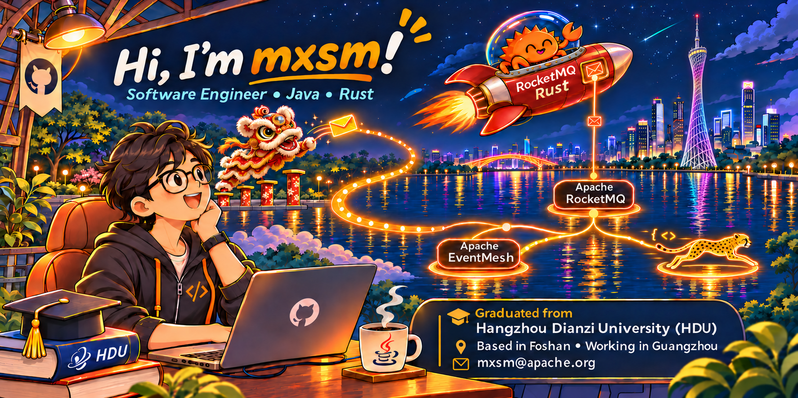
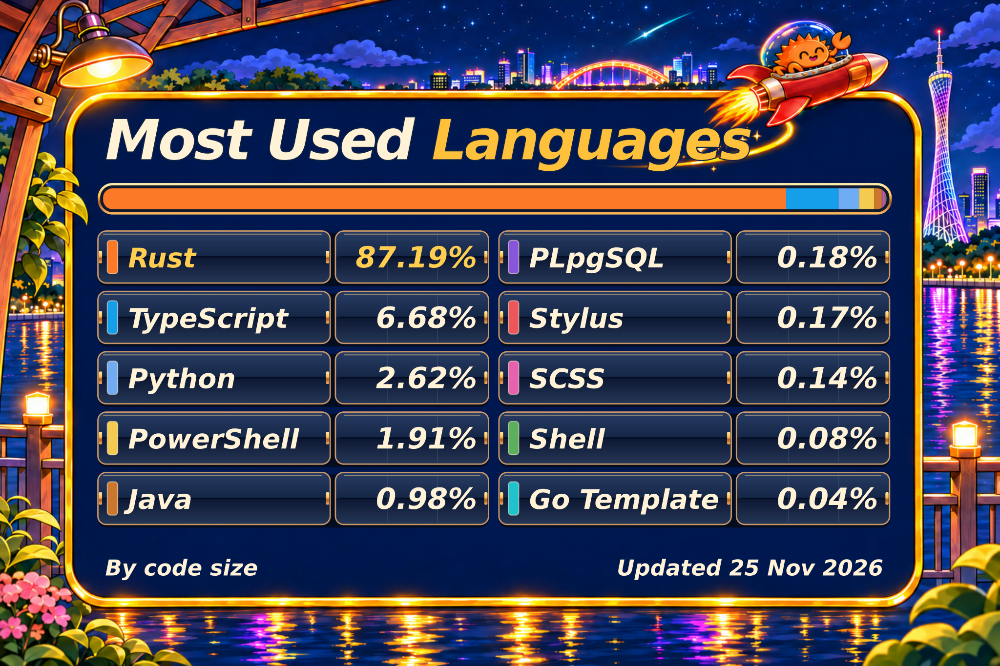

I’m a Java and Rust developer living in Foshan and working in Guangzhou. I graduated from Hangzhou Dianzi University (HDU).

- 🌱 I work on [RocketMQ Rust](https://github.com/mxsm/rocketmq-rust), [Apache RocketMQ](https://github.com/apache/rocketmq), [Apache EventMesh](https://github.com/apache/eventmesh), and [DLedger](https://github.com/openmessaging/dledger).
- 🤝 If you’d like to work on RocketMQ Rust together, email me at [mxsm@apache.org](mailto:mxsm@apache.org).
- 👉 [My personal website](https://blog.ljbmxsm.com)

<!--
### Technologies 💻
<table>
  <tr>
    <td></td>
    <td></td>
    <td></td>
    <td></td>
    <td></td>
    <td></td>
    <td></td>
  </tr>
  <tr>
    <td></td>
    <td></td>
    <td></td>
    <td></td>
    <td></td>
    <td></td>
    <td></td>
  </tr>
</table>
-->

<!--
### Contributing projects

-->

<!--  -->

<!--

-->

<!-- The original counter still records image requests. The lion card displays its daily total. -->

  
  

<!--

  <h3 align="center"> 
    Visitors Count 
    
  </h3>

</img>
-->

<!--

[;Wish%20you%20can%20Day%20Day%20Up%20every%20day!)](https://git.io/typing-svg)

  

**mxsm/mxsm** is a ✨ _special_ ✨ repository because its `README.md` (this file) appears on your GitHub profile.
-->
